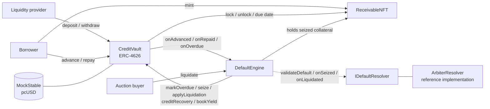
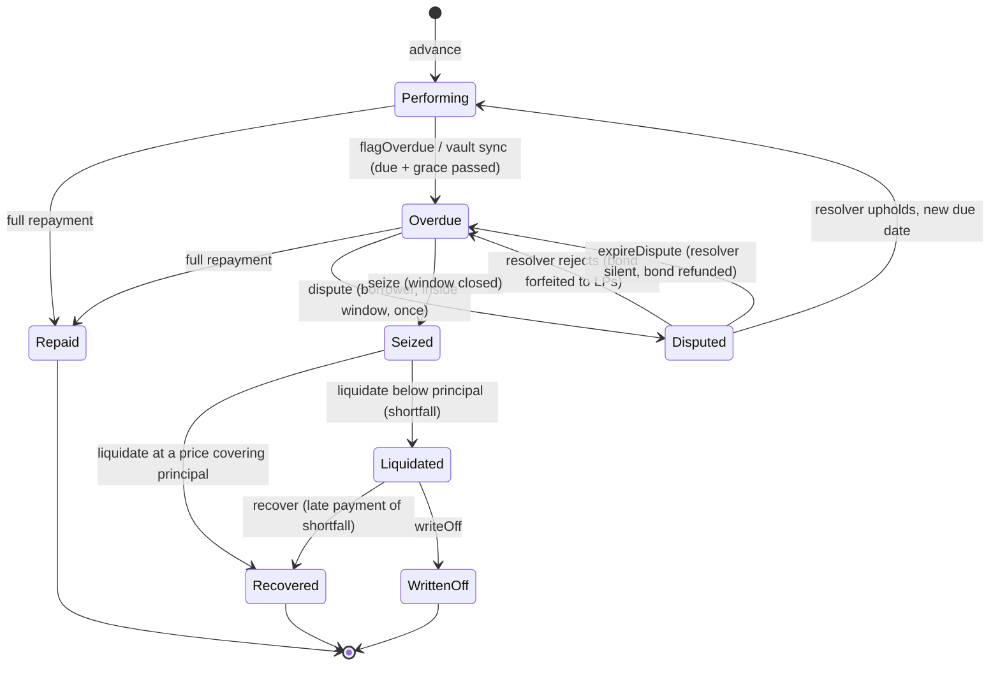

# PortalCredit Contracts

**An ERC-4626 credit vault for tokenised invoices with a fully on-chain default lifecycle.**

Borrowers finance invoices (receivables) as NFTs and receive a stablecoin advance. Liquidity providers (LPs) fund the
vault and earn the origination fee. When a borrower does not pay, a permissionless state machine handles dispute,
seizure, Dutch-auction liquidation and loss allocation, and the LP share price reflects the loss from the moment the
default becomes visible on chain. Built for the Portaldot Hacker House 2026 (Ecosystem DApps track).

> **Status: hackathon prototype, not audited.** Tests, coverage and static analysis are listed below. Portaldot V3
> testnet deployment is pending (see [Deployment](#deployment)). Do not use with real funds.

---

## Contents

1. [How it works](#how-it-works)
2. [Architecture](#architecture)
3. [Contracts](#contracts)
4. [Roles and permissions](#roles-and-permissions)
5. [Loan lifecycle](#loan-lifecycle)
6. [Accounting](#accounting)
7. [Parameters](#parameters)
8. [Security model](#security-model)
9. [Testing and verification](#testing-and-verification)
10. [Getting started](#getting-started)
11. [Deployment](#deployment)
12. [Integration notes](#integration-notes)
13. [Third-party code and license](#third-party-code-and-license)

---

## How it works

1. A borrower mints a `ReceivableNFT` describing an invoice: face value, due date and a hash of the obligor.
2. The borrower calls `CreditVault.advance(tokenId)`. The vault lends **80% of face value** in the stablecoin and
   locks the NFT as collateral. A **2% origination fee** (on the principal) becomes owed on top.
3. The borrower repays with `repay(tokenId, amount)`. Fees are settled first, then principal. When the debt reaches
   zero the NFT is unlocked and returned. LPs earn the fee (a share goes to the treasury).
4. If the borrower does not repay by due date plus grace, anyone can call `flagOverdue`. The vault immediately
   **writes the loan down to its expected recovery**, so the LP share price drops now, not days later.
5. The borrower may dispute once inside the dispute window. A resolver rules. If nothing is upheld, anyone can
   `seize` the collateral and sell it in a Dutch auction with `liquidate`. Late recoveries can be credited back to LPs
   with `recover`; remaining losses are accepted with `writeOff`.

The resolver is pluggable (`IDefaultResolver`), so an external default protocol such as Portaldot's DaaS can replace
the reference `ArbiterResolver` without touching the vault or engine.

## Architecture



The vault owns the money and the loan accounting. The engine owns the default state machine and is the only
contract allowed to call the vault's default hooks. The NFT enforces the collateral lock on every transfer path.

## Contracts

| Contract | Responsibility |
|---|---|
| `CreditVault` | ERC-4626 vault. Tracks idle cash, outstanding principal and write-downs. Originates advances, takes repayments, prices shares, keeps a due-date queue that recognises overdue loans, and exposes engine-only hooks. |
| `DefaultEngine` | Per-receivable state machine: flagging, disputes (optional bond), seizure, Dutch-auction liquidation, recovery and write-off. Permissionless except dispute rulings and early write-off. |
| `ReceivableNFT` | One ERC-721 per invoice. While financed it is locked and can only move vault to engine and back, so collateral cannot be sold out from under LPs. |
| `ArbiterResolver` | Reference `IDefaultResolver`: an owner-controlled arbiter (a multisig in production) that rules on disputes and can veto the seizure of a specific receivable. |
| `MockStable` | 6-decimal test stablecoin (`pcUSD`) with a one-time `faucet()`. **Testnet only.** |
| `interfaces/` | `ICreditVault`, `IDefaultEngine`, `IDefaultResolver`: the surfaces the contracts depend on. |

### CreditVault: main functions

| Function | Who | Purpose |
|---|---|---|
| `deposit` / `mint` / `withdraw` / `redeem` | LPs | Standard ERC-4626 entry points. Each first recognises overdue loans (`sync`), then prices shares. |
| `advance(tokenId)` | NFT owner | Borrow 80% of face value against an approved receivable. |
| `repay(tokenId, amount)` | Anyone | Pay fee then principal while the loan is Performing, Overdue or Disputed. |
| `sync(maxSteps)` | Anyone | Recognise overdue loans from the due-date queue (bounded work). |
| `totalAssets`, `sharePrice`, `spendableCash`, `utilizationBps`, `debtOf`, `needsSync` | Views | Accounting and gating state. |
| `markOverdue`, `clearImpairment`, `seize`, `setDueDate`, `applyLiquidation`, `creditRecovery`, `bookYield` | Engine only | Default hooks. |
| `setEngine` (once), `setTreasury`, `setAdvanceRateBps`, `setOriginationFeeBps`, `setProtocolFeeBps`, `setReserveBps`, `pause`, `unpause` | Owner | Configuration, all within hard bounds. |

### DefaultEngine: main functions

| Function | Who | Purpose |
|---|---|---|
| `flagOverdue(tokenId)` | Anyone | After due date plus grace: status becomes Overdue, the vault books the write-down, the dispute window opens. |
| `dispute(tokenId, evidence)` | Borrower | Contest the default once inside the window, posting an optional bond. |
| `resolveDispute(tokenId, upheld, newDueDate)` | Resolver | Upheld: loan returns to Performing with a new due date and the write-down is cleared. Rejected: bond goes to LPs. |
| `expireDispute(tokenId)` | Anyone | If the resolver stays silent past the timeout, returns the loan to Overdue and refunds the bond. |
| `seize(tokenId)` | Anyone | After the dispute window: takes custody of the collateral (resolver can veto). |
| `liquidate(tokenId, maxPrice)` | Anyone | Buy the collateral at the current auction price and receive the NFT. |
| `recover(tokenId, amount)` | Anyone | Pay back part of the remaining shortfall to LPs. |
| `writeOff(tokenId)` | Owner, or anyone after the recovery period | Accept the remaining shortfall as a loss. |
| `currentPrice`, `statusOf`, `timeline` | Views | Auction price, state and the full checkpoint history. |

### Receivable and resolver

`ReceivableNFT.mint(faceValue, dueDate, obligor, metadataURI)` is open to anyone; `lock`, `unlock` and `updateDueDate`
are vault-only. `ArbiterResolver` exposes `resolve(tokenId, upheld, newDueDate)` and `setVeto(tokenId, value)` to its
owner, and its notification hooks only accept calls from the engine.

## Roles and permissions

| Role | Can | Cannot |
|---|---|---|
| **LP** | Deposit and withdraw (subject to the gates below). | Withdraw at a price that ignores a visible default; deposit while a write-down is open. |
| **Borrower** | Mint receivables, advance, repay, dispute once. | Move a financed NFT, repay after seizure. |
| **Keeper / anyone** | Flag overdue, seize, sync, recover, repay on someone's behalf, write off after the recovery period. | Resolve disputes, change parameters. |
| **Auction buyer** | Buy seized collateral at the current price. | Pay more than their `maxPrice`. |
| **Resolver** | Rule on disputes, veto a seizure (via `validateDefault`). | Move funds or collateral. |
| **Owner** | Change parameters within bounds, pause, set the resolver, write off early. | Move LP funds or collateral directly. |

## Loan lifecycle



A borrower can repay while the loan is Performing, Overdue or Disputed. Repayment is blocked once the collateral is
seized.

## Accounting

All amounts are in the vault asset (6 decimals). Shares use a 6-decimal virtual offset (12 decimals total) to defeat
first-depositor inflation attacks.

```
totalAssets  = idleCash + outstandingPrincipal - totalImpairment
principal    = faceValue * advanceRateBps / 10_000
fee          = principal * originationFeeBps / 10_000          (owed on top, paid before principal)
treasury cut = feePaid * protocolFeeBps / 10_000
write-down   = principal * (10_000 - floorBps) / 10_000        (booked when a loan is recognised as overdue)
floor price  = debt * floorBps / 10_000
auction price(t) = debt - (debt - floor price) * elapsed / auctionDuration      (clamped at the floor)
spendableCash = max(0, idleCash - totalAssets * reserveBps / 10_000)
```

- `idleCash` is tracked internally, so donated tokens cannot move the share price.
- The write-down shrinks proportionally on partial repayment, is cleared on full repayment or an upheld dispute, and
  is replaced by the real result at liquidation.
- The liquidation waterfall pays principal first, then fee. Unrecovered principal is an LP loss that can be recovered
  later with `recover` or accepted with `writeOff`.

### Trading gates (why LPs cannot dodge or harvest a default)

| Condition | Effect |
|---|---|
| A loan is past due + grace but not yet recognised | `maxWithdraw`, `maxRedeem`, `maxDeposit`, `maxMint` return 0. Every deposit/withdraw call first recognises up to `MAX_SYNC_STEPS` (8) such loans; `sync(n)` clears larger backlogs. |
| Any write-down is open (`totalImpairment > 0`) | Deposits and mints are closed, so nobody buys depressed shares and shares in an auction recovery they did not carry. They reopen when the loss is settled. |
| Paused | All four limits return 0. |
| Normal | Withdrawals are limited by `spendableCash`. |

## Parameters

| Parameter | Default | Bound | Set by |
|---|---|---|---|
| Advance rate | 80% of face | 0 < rate <= 95% | Owner (vault) |
| Origination fee | 2% of principal | <= 10% | Owner (vault) |
| Protocol fee | 20% of fees | <= 50% | Owner (vault) |
| Liquidity reserve | 5% of NAV | <= 20% | Owner (vault) |
| Grace period | 3 days | <= 90 days | Owner (engine) |
| Dispute window | 3 days | <= 90 days | Owner (engine) |
| Auction duration | 2 days | 1 s to 90 days | Owner (engine) |
| Auction floor | 40% of debt | 10% to 100% | Owner (engine) |
| Dispute resolution timeout | 7 days | 1 s to 90 days | Owner (engine) |
| Recovery period before public write-off | 30 days | <= 365 days | Owner (engine) |
| Dispute bond | 0 | none | Owner (engine) |
| Overdue sync steps per call | 8 | constant | n/a |

For live demos, `DEMO_WINDOWS=true` in the deploy script shortens grace, dispute window, auction and resolution
timeout to minutes using the normal owner setters.

## Security model

**Enforced by the code**

- Reentrancy: all vault entry points (including the ERC-4626 functions and `sync`) and all engine entry points use
  `nonReentrant`. The resolver validation call is a `STATICCALL`.
- Collateral custody: a financed NFT can only move vault to engine and back (checked in `_update`, covering every
  transfer path).
- Solvency: tests assert the vault holds at least `idleCash`, aggregate counters equal the sum over loans, and LP
  claims never exceed assets.
- Failure isolation: resolver notification hooks are wrapped in `try/catch`; an explicit `false` from
  `validateDefault` vetoes a seizure, while a broken resolver cannot block it. `setResolver` rejects non-contracts.
- Liveness: if the resolver never rules on a dispute, anyone can call `expireDispute` after the timeout.
- Bounds and pausing: every owner setter has an upper bound; the vault and engine can be paused.

**Trust assumptions and limitations**

1. The reference `ArbiterResolver` is a single owner (a multisig in production). Whoever owns it decides disputes and
   can veto a seizure.
2. The owner can change parameters within bounds, pause, and write off a liquidated loan early. It cannot move LP
   funds or collateral directly.
3. Invoice validity and obligor creditworthiness are not verified on chain (`obligor` is an opaque hash). A real
   deployment needs legal structure, KYC and an attestation layer.
4. No interest accrual or late penalties: yield is a flat origination fee.
5. The Dutch auction needs a buyer; LPs bear any shortfall below the floor.
6. Designed for one 6-decimal stablecoin; fee-on-transfer and rebasing tokens are unsupported.
7. Exits before due + grace are possible at full price (the loan is still performing). Deposits are paused while a
   default is unresolved. See `docs/security.md` in the main repository for the full discussion.
8. Behaviour was tested on a standard EVM. Whether plain solc bytecode deploys on Portaldot V3 is not yet confirmed.

An external review found that losses used to be recognised only at seizure, letting informed LPs exit first. That is
fixed (write-down at recognition, a due-date queue, trading gates) and covered by dedicated tests.

## Testing and verification

| Check | Result |
|---|---|
| `forge test` | 109 tests pass: unit, fuzz, adversarial LP timing, access control, 8 stateful invariants |
| `forge coverage` | 100% lines, statements, branches and functions on `src/` |
| Heavy fuzz run | 600 invariant runs x depth 80, 3,000 fuzz runs: all pass |
| `solhint` | No errors or warnings (config in `.solhint.json`) |
| `slither` | No High or Medium findings; Low/Informational items triaged in the main repo's `docs/security.md` |

Key test files in `test/`:

- `PortalCredit.t.sol`: vault and engine behaviour, including resolver failure modes.
- `Economic.t.sol`: the exit-after-flag, exit-before-flag and late-deposit scenarios, plus a fuzz property that no exit
  time after due + grace shifts losses onto the remaining LPs.
- `OverdueQueue.t.sol`: due-date queue ordering, backlogs, write-down lifecycle and hook guards.
- `Invariant.t.sol`: a handler that randomly deposits, borrows, repays, flags, disputes, rules, seizes, liquidates and
  recovers, asserting the invariants after every sequence.
- `Coverage.t.sol`: admin surface, guard clauses and engine-only hooks.

Coverage shows that every line ran, not that the economics are right; the adversarial tests exist for that reason.

## Getting started

Requirements: [Foundry](https://getfoundry.sh) (`curl -L https://foundry.paradigm.xyz | bash`, then `foundryup`),
Node.js for `solhint`, Python for `slither`. Solidity 0.8.24, EVM version `paris`, OpenZeppelin Contracts v5.1.0
vendored in `lib/`.

```bash
forge build
forge test                                            # all tests
forge test --match-contract EconomicTest -vv          # the exit-timing scenarios
forge coverage --no-match-coverage "(test|script)"    # coverage of src/ only

npx solhint 'src/**/*.sol'

slither src/CreditVault.sol --compile-force-framework solc \
  --solc-remaps "@openzeppelin/contracts/=lib/openzeppelin-contracts/contracts/" \
  --solc-args "--evm-version paris --optimize --optimize-runs 200" --filter-paths "lib/"
# repeat for DefaultEngine, ReceivableNFT and ArbiterResolver
```

Layout:

```
src/        CreditVault, DefaultEngine, ReceivableNFT, ArbiterResolver, MockStable, interfaces/
test/       Base, PortalCredit, Economic, OverdueQueue, Coverage, Invariant
script/     Deploy.s.sol
lib/        OpenZeppelin Contracts v5.1.0, forge-std
```

## Deployment

`script/Deploy.s.sol` deploys and wires the whole system, then writes `deployments/<chainid>.json`.

| Variable | Required | Meaning |
|---|---|---|
| `PRIVATE_KEY` | yes | Deployer key (becomes owner of every contract). Never commit it. |
| `TREASURY` | no | Fee recipient; defaults to the deployer. |
| `SEED_LIQUIDITY` | no | pcUSD (6 decimals) the deployer mints and deposits as the first LP. Default 0. |
| `DEMO_WINDOWS` | no | `true` shortens grace, dispute, auction and resolution windows to minutes. |

```bash
# local
anvil
PRIVATE_KEY=<anvil key> SEED_LIQUIDITY=10000000000 DEMO_WINDOWS=true \
  forge script script/Deploy.s.sol --rpc-url http://127.0.0.1:8545 --broadcast

# Portaldot V3 testnet
forge script script/Deploy.s.sol --rpc-url https://test-evm-rpc-v3.portaldot.dev --legacy --slow --broadcast
```

Deployment order: `MockStable`, `ReceivableNFT`, `CreditVault`, `DefaultEngine`, `ArbiterResolver`; then
`engine.setResolver`, `nft.setWiring`, `vault.setEngine`, optional demo windows and seed liquidity.

**Portaldot V3 testnet:** EVM RPC `https://test-evm-rpc-v3.portaldot.dev`, chain ID `420420777`, explorer
`https://node-console.portaldot.dev/`. Contract creation with plain solc bytecode has been rejected by the node
(error 1010 Invalid Transaction); the supported compile or deploy path is still being confirmed.

### Deployed addresses

| Network | Contract | Address | Tx hash |
|---|---|---|---|
| Portaldot V3 testnet | | _pending_ | _pending_ |

## Integration notes

- Frontends should read `totalAssets`, `sharePrice` (assets per 1 whole share, 12 decimals), `maxDeposit`,
  `maxWithdraw`, `needsSync` and the engine's `statusOf`, `timeline` and `currentPrice`.
- Approvals: borrowers approve the NFT to the vault before `advance`, and pcUSD to the vault before `repay`. Bonds for
  `dispute` are pulled by the engine. Auction payments and `recover` payments are pulled by the vault.
- If a deposit or withdrawal reverts with an ERC-4626 `ExceededMax...` error, check `needsSync()` and call
  `sync(n)`, or check whether a write-down is open (deposits are paused until it is settled).
- Key events: `Advanced`, `Repaid`, `LoanClosed`, `Impaired`, `ImpairmentCleared`, `Seized`, `LiquidationApplied` on
  the vault; `FlaggedOverdue`, `Disputed`, `DisputeResolved`, `Seized`, `Liquidated`, `Recovered`, `WrittenOff` on the
  engine.
- Custom errors are used throughout (for example `BadStatus`, `NotYet`, `PriceTooHigh`, `InsufficientLiquidity`).

## Third-party code and license

- [OpenZeppelin Contracts](https://github.com/OpenZeppelin/openzeppelin-contracts) v5.1.0 (MIT): ERC-20, ERC-721,
  ERC-4626, Ownable, Pausable, ReentrancyGuard, SafeERC20, SafeCast, Math.
- [forge-std](https://github.com/foundry-rs/forge-std) (MIT / Apache-2.0): test and script helpers.
- Development used AI assistance (Claude). All code in this repository was written during the Hacker House period.

Source files are licensed under MIT (see the SPDX headers).
