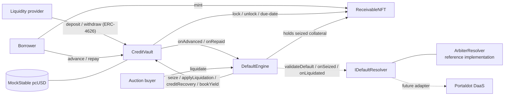
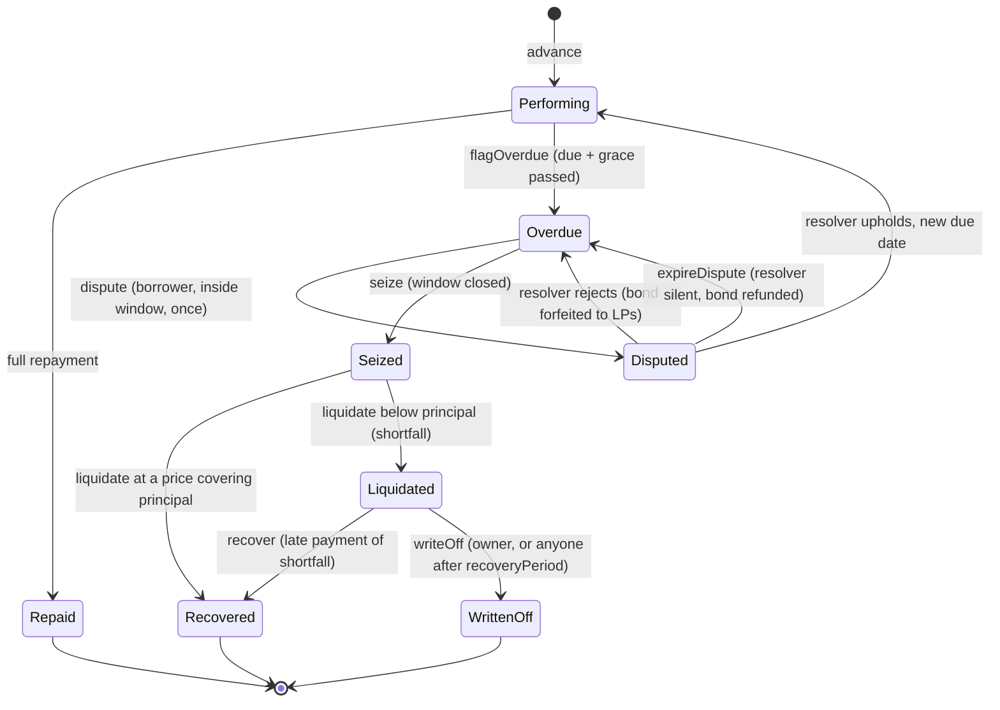
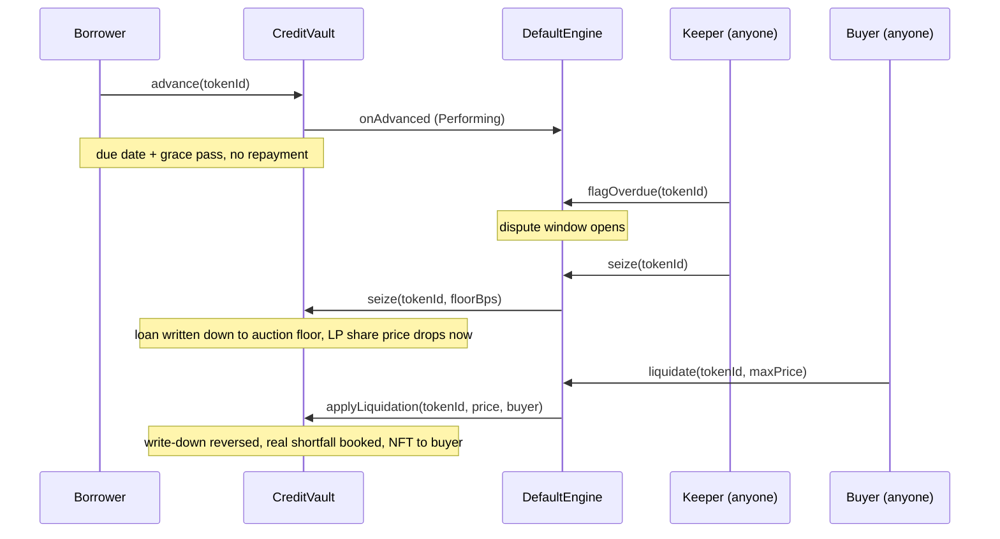

# PortalCredit architecture

PortalCredit is an RWA credit vault whose differentiator is an on-chain default lifecycle. Borrowers finance
invoices (receivables); LPs fund the vault; when a loan goes bad, a permissionless, auditable state machine
handles dispute, seizure, liquidation and loss allocation instead of an off-chain process.

## Components



| Contract | Responsibility |
|---|---|
| `ReceivableNFT` | One ERC-721 per invoice (face value, due date, obligor hash, URI). While financed it is locked and can only move vault <-> engine, so collateral cannot be sold out from under LPs. |
| `CreditVault` | ERC-4626 vault. Tracks idle cash, outstanding principal and impairment. Originates advances (80% of face by default), takes repayments (fee first, then principal), and exposes engine-only hooks. |
| `DefaultEngine` | Per-receivable state machine, dispute handling with an optional bond, Dutch-auction liquidation, recovery and write-off. Permissionless except dispute rulings and early write-off. |
| `IDefaultResolver` | Pluggable backend for dispute rulings and seizure validation. |
| `ArbiterResolver` | Reference resolver: an owner-controlled arbiter that can rule on disputes and veto a seizure. |
| `MockStable` | 6-decimal test stablecoin with a one-time faucet. Testnet only. |

## Default lifecycle



A borrower can still repay while a loan is `Performing`, `Overdue` or `Disputed`. Repayment is blocked once the
collateral is seized.

## Sequence: a default from advance to loss



## Accounting

```
totalAssets = idleCash + outstandingPrincipal - totalImpairment
```

- `idleCash` is internal bookkeeping, so donated tokens cannot change the share price.
- Yield is the origination fee (2% of principal by default), owed on top of principal and paid on repayment.
  20% of fees go to the treasury, 80% accrue to LPs.
- At seizure the loan is impaired to its expected recovery (principal scaled by the 40% auction floor), so LPs see
  a confirmed default immediately. At liquidation the impairment is removed and the real result is booked.
- The liquidation waterfall pays principal first, then fee. Any unrecovered principal is an LP loss that can be
  recovered later with `recover` or accepted with `writeOff`.
- 6-decimal virtual share offset defeats first-depositor inflation attacks.

## Default parameters

| Parameter | Default | Bound |
|---|---|---|
| Advance rate | 80% of face | <= 95% |
| Origination fee | 2% of principal | <= 10% |
| Protocol fee | 20% of fees | <= 50% |
| Liquidity reserve | 5% of NAV | <= 20% |
| Grace period | 3 days | <= 90 days |
| Dispute window | 3 days | <= 90 days |
| Auction duration / floor | 2 days / 40% of debt | floor 10% to 100% |
| Dispute resolution timeout | 7 days | <= 90 days |
| Recovery period before public write-off | 30 days | <= 365 days |

For live demos, `DEMO_WINDOWS=true` in the deploy script shortens grace, dispute window and auction to minutes
using the normal owner setters.

## Why Portaldot

Portaldot's own protocol stack centres on DaaS (Default-as-a-Service) for RWA, DeFi and cross-chain settlement.
PortalCredit implements a full default lifecycle behind `IDefaultResolver`, so it can run standalone today and
adopt the official DaaS as the resolver when an interface is available. Portaldot V3 adds EVM contract support
alongside WASM, which is what makes a Solidity credit vault possible on the network.
